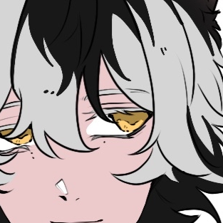

  <!-- เปลี่ยนรูปหน้าปกโดยแทนที่ไฟล์ assets/cover.png ใน seashyne-attachments -->
  
  <h1>Hi, I'm sea — seashyne</h1>
  
สวัสดี ผม sea นักพัฒนาที่ชอบสร้างเครื่องมือ ภาษาโปรแกรม และระบบเรนเดอร์

  
TH | EN | 中文 | 日本語

## About Me

- I build tools, programming languages, renderers, and small experiments.
- ตอนนี้กำลังพัฒนา [lenout](https://www.lenout.com/) เครื่องมือวาดภาพและออกแบบบนเบราว์เซอร์
- สนใจงานที่อยู่ตรงกลางระหว่างการเขียนโค้ด การออกแบบ และความคิดสร้างสรรค์
- เว็บแนะนำตัว: [seashyne.github.io/seashyne-attachments](https://seashyne.github.io/seashyne-attachments/)

## Current Focus

- Building **lenout**, a browser-based tool for illustrations, social posts, and presentations
- Making a **2D + 3D web renderer** with hybrid compute
- Making creative tools easier and more enjoyable to use

## Featured Project

### [lenout.com](https://www.lenout.com/)

Draw illustrations, design social posts or presentations, and collaborate live with others in your browser.

วาดภาพประกอบ ออกแบบโพสต์โซเชียลหรือพรีเซนเทชัน และร่วมงานกับผู้อื่นแบบเรียลไทม์ผ่านเบราว์เซอร์

## Find Me

- GitHub: [@seashyne](https://github.com/seashyne)
- lenout: [lenout.com](https://www.lenout.com/)
- X: [@SeaKrapow](https://x.com/SeaKrapow)
- ORCID: [0009-0003-5483-3876](https://orcid.org/0009-0003-5483-3876)
- Email: [seashyne@outlook.com](mailto:seashyne@outlook.com)
